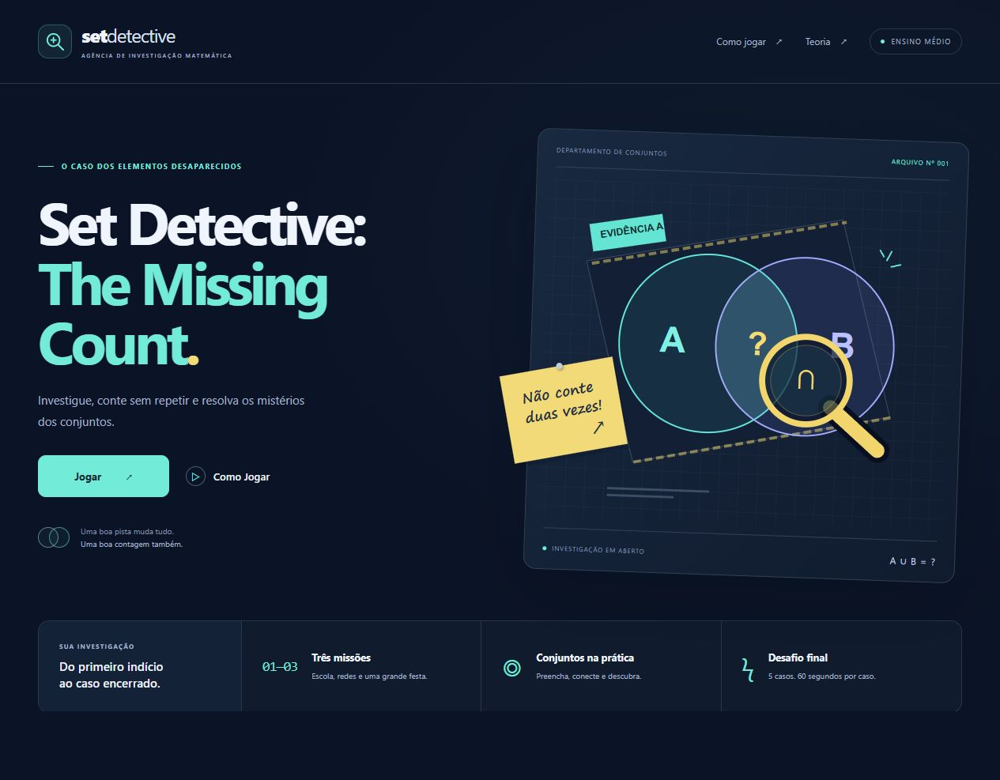

# 🔎 Set Detective: The Missing Count

**Investigue, conte sem repetir e resolva os mistérios dos conjuntos.**

Jogo educativo interativo para estudantes brasileiros do ensino médio, com foco em **cardinalidade**, **diagramas de Venn** e **princípio da inclusão-exclusão**. O estudante lê as pistas, preenche as regiões dos conjuntos e explica uma contagem sem duplicar pessoas.

**[▶ Jogar agora](https://arthurlaragao.github.io/set-detective/)** · [Como executar](#como-executar) · [Missões](#missões) · [Equipe](#equipe)



## Sobre o projeto

Uma investigação matemática em uma única página, com visual de dossiê: azul-escuro, pistas em ciano, detalhes em amarelo e diagramas editáveis. O conteúdo e os feedbacks estão em português brasileiro.

O projeto foi desenvolvido com **HTML, CSS e JavaScript puros**, sem frameworks, bibliotecas, ferramentas de build, fontes externas ou serviços de backend. Depois de baixar os arquivos, o jogo também funciona sem internet.

## O que você encontra

- **Início:** apresentação da investigação e identificação da equipe.
- **Como Jogar:** instruções de preenchimento, símbolos e regras de pontuação.
- **Teoria:** nove cartões com exemplos de conjunto, universo, cardinalidade, união, interseção, diferença, complementar, diagrama de Venn e inclusão-exclusão.
- **Três missões guiadas:** pistas, diagrama interativo, campos sincronizados, dicas progressivas e validação de todas as regiões.
- **Desafio final:** cinco problemas aleatórios de dois ou três conjuntos, com uma pergunta final e 60 segundos por questão.
- **Relatório:** pontuação total, precisão, melhor missão e mensagem personalizada.

## Como jogar

1. Leia a história e as pistas confirmadas.
2. Identifique o universo e a interseção dos conjuntos.
3. Preencha os números diretamente nas regiões do diagrama ou no painel de respostas. Os campos ficam sincronizados.
4. Clique em **Verificar**. As regiões incorretas recebem destaque e uma orientação para revisar a dedução.
5. Use **Dica** quando precisar. As dicas avançam por etapas, sem entregar todas as respostas de uma vez.
6. Depois de acertar todos os campos, leia a explicação e avance para a próxima missão.
7. No desafio final, use o diagrama como rascunho opcional e responda à pergunta final antes do tempo acabar.

> **Pista importante:** nos problemas com três conjuntos, as interseções dos pares incluem quem pertence aos três. Para preencher a região de apenas um par, desconte a interseção tripla.

## Missões

| Missão | Universo | Investigação | Conceitos principais |
| --- | --- | --- | --- |
| **01 · Clube Escolar** | 40 estudantes | Futebol, basquete, ambos e nenhum | Interseção, regiões exclusivas e união de dois conjuntos |
| **02 · Redes Sociais** | 100 estudantes | Instagram, TikTok, ambas as redes e nenhuma | Inclusão-exclusão e complemento da união |
| **03 · Festa de Lançamento** | 200 convidados | Preferências por jogos, filmes e música | Três conjuntos, pares exclusivos e interseção tripla |
| **Desafio final** | Gerado a cada questão | Cinco novos casos com pistas consistentes | Aplicação dos conceitos com limite de tempo |

Os problemas aleatórios são criados a partir de regiões disjuntas não negativas. Os totais de cada conjunto, as interseções e o universo são derivados dessas regiões, garantindo consistência entre as pistas e as respostas.

## A matemática por trás do caso

### Dois conjuntos

```text
n(A ∪ B) = n(A) + n(B) − n(A ∩ B)
```

Ao somar A e B, quem pertence aos dois aparece duas vezes. Subtraímos uma ocorrência da interseção.

### Três conjuntos

```text
n(A ∪ B ∪ C) = n(A) + n(B) + n(C)
              − n(A ∩ B) − n(A ∩ C) − n(B ∩ C)
              + n(A ∩ B ∩ C)
```

Os elementos da região central foram somados três vezes e subtraídos três vezes. Somamos a interseção tripla para que cada um conte uma única vez.

### Fora dos conjuntos

```text
Nenhum = n(U) − n(A ∪ B)
```

Para três conjuntos, usamos `n(U) − n(A ∪ B ∪ C)`. O universo `U` é o grupo inteiro considerado no problema.

## Pontuação e tempo

| Regra | Comportamento |
| --- | --- |
| Missão resolvida | Começa valendo **300 pontos** |
| Verificação incorreta nas missões | Desconto de **30 pontos** no valor da missão |
| Dica nova nas missões | Desconto de **20 pontos** no valor da missão |
| Pontuação mínima por missão resolvida | **100 pontos** |
| Acerto no desafio final | **100 pontos**, sem desconto por dica |
| Limite do desafio | **60 segundos por questão**, com uma tentativa numérica válida |
| Tempo esgotado | Encerra a questão sem pontos e mostra a explicação |
| Pontuação máxima da partida | **1.400 pontos** |

Nas missões, o relógio registra o tempo sem impor limite. No desafio, abrir a ajuda, a teoria, as instruções ou voltar ao início pausa o relógio; deixar a aba em segundo plano não pausa a contagem.

A **precisão** corresponde às verificações corretas divididas pelo total de verificações, incluindo os tempos esgotados. A **melhor missão** é a de maior pontuação; em caso de empate, vence a de menor tempo.

## Como executar

### Pelo navegador

Abra o jogo publicado no **[GitHub Pages](https://arthurlaragao.github.io/set-detective/)**. Não é necessário criar conta.

### No seu computador

1. Baixe o repositório em **Code → Download ZIP** e extraia os arquivos, ou clone:

   ```bash
   git clone https://github.com/ArthurLAragao/set-detective.git
   cd set-detective
   ```

2. Abra `index.html` no navegador.

Mantenha `index.html`, `style.css` e `script.js` na mesma pasta. Não é necessário instalar pacotes.

Se preferir usar um servidor local e já tiver Python instalado:

```bash
python -m http.server 8000 --bind 127.0.0.1
```

Depois, abra [http://127.0.0.1:8000](http://127.0.0.1:8000). Em sala de aula, a tecla **F11** ativa a tela cheia nos navegadores mais comuns do Windows.

## Estrutura dos arquivos

```text
set-detective/
├── index.html                  # Telas, conteúdo e estrutura semântica
├── style.css                   # Identidade visual, responsividade e animações
├── script.js                   # Regras, cálculos, missões, relógios e interação
├── README.md                   # Documentação do projeto
├── .nojekyll                   # Publicação estática direta no GitHub Pages
├── .gitignore                  # Arquivos locais que não devem ser versionados
├── .gitattributes              # Quebras de linha consistentes entre sistemas
├── .github/workflows/checks.yml # Verificação automática do JavaScript e da matemática
├── docs/
│   ├── preview.png             # Captura real da tela inicial
│   └── VALIDACAO.md            # Escopo e resultados das verificações
└── tests/
    └── math.test.cjs           # Testes reproduzíveis dos cálculos e regras
```

## Testes e validação

Para executar as verificações matemáticas, é necessário ter **Node.js** instalado. Isso é opcional para jogar.

```bash
node --check script.js
node tests/math.test.cjs
```

A suíte confere os gabaritos das três missões, as regras de pontuação, a validação de entradas e **10.000 problemas aleatórios com semente reproduzível**. A execução validada realizou **179.723 asserções**. As mesmas verificações estão configuradas no GitHub Actions para pushes e pull requests.

O fluxo completo também foi exercitado em navegador, incluindo erros, dicas, timeout real de 60 segundos, relatório final e reinício. Veja o detalhamento e os limites dessas verificações em [docs/VALIDACAO.md](docs/VALIDACAO.md).

## Acessibilidade e privacidade

- Layout adaptável a desktop, tablet e celular.
- Navegação por teclado, rótulos nos campos e foco visível.
- Feedback com mensagens textuais e atributos de acessibilidade, além das cores.
- Respeito à preferência de movimento reduzido.
- Diagramas desenhados com SVG interno e campos HTML editáveis.
- Sem login, banco de dados, analytics ou coleta de dados pelo código do jogo.

O progresso fica apenas na memória da página: recarregar ou fechar a aba reinicia a partida. Os registros de acesso da hospedagem seguem o funcionamento do GitHub Pages.

## Publicação no GitHub Pages

O site usa a branch **`main`** e a pasta **`/ (root)`** como origem. Não há etapa de build da aplicação. Alterações publicadas nessa branch disparam a atualização da hospedagem pelo GitHub Pages.

O workflow `checks.yml` verifica a sintaxe e os cálculos; a publicação é feita pelo mecanismo de Pages configurado no repositório.

## Equipe

- Samuel Barbosa Mendes Passos
- Luan Bruno Lopes Pontes
- Francisco Chagas de Souza Santos Filho
- Antonio Juliao Martins Neto
- João Pedro Silva Peixoto

---

**Cada elemento tem seu lugar. Cada pessoa conta uma vez só.**
